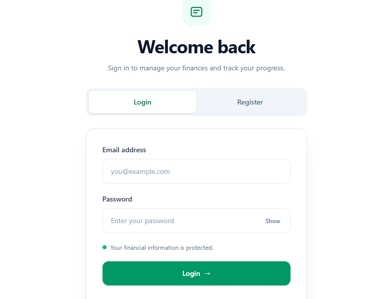
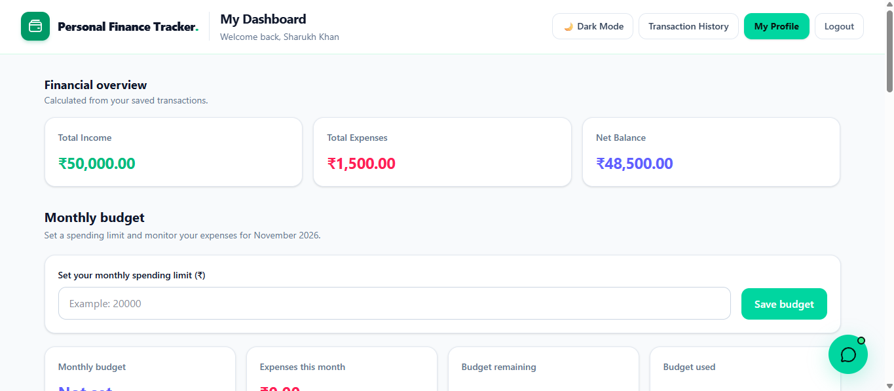
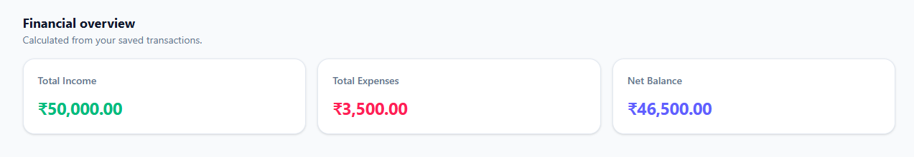
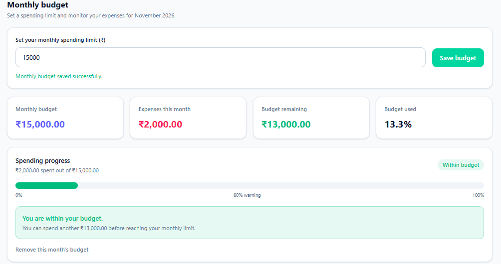
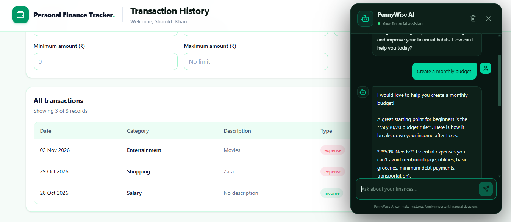
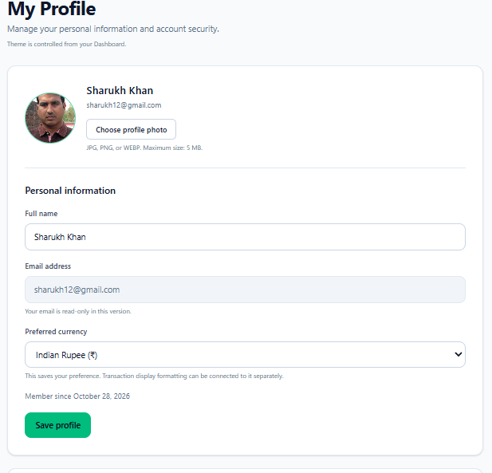
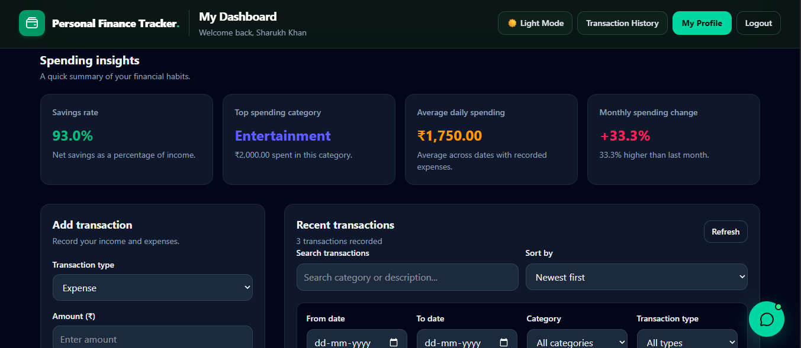

# 💰 Personal Finance Tracker

<p align="center">
  **Take Control of Your Money. Make Smarter Financial Decisions.**
</p>

<p align="center">
  <a href="https://personal-finance-tracker-frontend-88ru.onrender.com">🌐 Live Application</a> •
  <a href="https://personal-finance-tracker-ana4.onrender.com">⚙️ Backend API</a>
</p>

---

## 📌 1. Introduction

**Personal Finance Tracker** is a full-stack web application designed to help individuals manage their personal finances, track income and expenses, monitor budgets, and make better financial decisions.

The application provides an interactive dashboard where users can manage their financial activities in one place. It also integrates AI-powered features to provide financial guidance, budget forecasting, and conversational assistance.

The main objective of this project is to simplify personal financial management by combining transaction tracking, intelligent financial insights, and an easy-to-use interface.

### 🎯 Project Objectives

- Simplify income and expense management.
- Help users understand their spending habits.
- Provide AI-powered financial assistance.
- Forecast budgets and support financial planning.
- Offer a centralized platform for managing personal finances.

---

## 🔗 2. Live Application

| Service | Link |
|---|---|
| 🌐 Frontend Application | https://personal-finance-tracker-frontend-88ru.onrender.com |
| ⚙️ Backend API | https://personal-finance-tracker-ana4.onrender.com |

---

## 🛠️ 3. Technology Stack

| Category | Technologies |
|---|---|
| Frontend | React.js, Vite, HTML, CSS, JavaScript |
| Backend | Node.js, Express.js |
| Database | MongoDB, Mongoose |
| Authentication | JWT, bcryptjs |
| AI Integration | Google Gemini API |
| API Communication | Fetch API, REST APIs |
| Deployment | Render |
| Version Control | Git, GitHub |

---

## 🚀 4. Key Features

### 4.1 User Authentication
- User registration and login.
- Secure password hashing.
- JWT-based authentication.
- Protected application routes.

### 4.2 Financial Dashboard
- View financial information in one place.
- Monitor total income and expenses.
- Track financial activity.
- Get a quick overview of personal finances.

### 4.3 Income and Expense Management
- Add new income and expense transactions.
- Edit existing transactions.
- Delete transactions.
- Organize and monitor financial records.

### 4.4 AI Financial Coach
- Get AI-powered financial guidance.
- Understand spending patterns.
- Receive suggestions for better money management.
- Support smarter financial decisions.

### 4.5 Budget Forecast
- Get insights to support future budget planning.
- Understand financial trends.
- Make more informed spending decisions.

### 4.6 AI Chatbot
- Interact with an AI-powered assistant.
- Ask finance-related questions.
- Get conversational assistance with financial management.

### 4.7 User Profile Management
- View and update profile information.
- Upload a profile picture.
- Change account password.
- Select preferred currency.

### 4.8 Dark and Light Mode
- Switch between dark and light themes.
- Enjoy a comfortable interface in different lighting conditions.

---

## 💡 5. Use Cases

| Use Case | Description |
|---|---|
| Personal Budget Management | Users can monitor their income and expenses to manage their money effectively. |
| Expense Tracking | Users can record daily spending and review their financial activities. |
| Financial Planning | Users can use budget forecasting insights to plan future expenses. |
| AI Financial Assistance | Users can ask the AI Financial Coach for financial guidance. |
| Financial Queries | Users can interact with the chatbot to ask finance-related questions. |
| Account Management | Users can update their profile, password, currency, and profile picture. |
| Spending Awareness | Users can review their financial activity to better understand spending habits. |

### 👥 Target Users

- Students managing monthly expenses.
- Working professionals tracking salaries and spending.
- Individuals planning personal budgets.
- People looking for AI-assisted financial guidance.
- Anyone interested in improving financial awareness.

---

## 🔍 6. Research and Complete Working Process

This section explains how the application works, from user registration to financial tracking and AI assistance.

### 6.1 System Architecture

The application follows a full-stack architecture.

```text
              USER
                |
                v
       React.js Frontend
                |
                v
          REST API Calls
                |
                v
       Node.js + Express.js
                |
         +------+------+
         |             |
         v             v
    MongoDB Atlas   Gemini API
         |             |
         v             v
   Financial Data   AI Responses
         |             |
         +------+------+
                |
                v
        Frontend Display
```

### 6.2 User Registration and Login

Users first create an account or log in using their credentials.

**Working process:**
1. User enters registration or login details.
2. Frontend sends the request to the backend.
3. Backend validates the information.
4. Passwords are securely hashed for registration.
5. JWT authentication is used to manage authenticated sessions.
6. The user is redirected to the dashboard after successful login.

**Screenshot:**



*Figure 1: User authentication and login interface.*

### 6.3 Dashboard Overview

After login, users can access the main dashboard to view their financial information.

**Working process:**
1. The frontend requests financial data from the backend.
2. The backend retrieves the user's records from MongoDB.
3. The dashboard displays the available financial information.
4. Users can monitor their income, expenses, and financial activities.

**Screenshot:**


*Figure 2: Main dashboard displaying financial information.*

### 6.4 Income and Expense Management

Users can manage their transactions directly from the dashboard.

**Working process:**
1. User selects the option to add a transaction.
2. User enters transaction details.
3. Frontend sends the information to the transaction API.
4. Backend processes and stores the transaction in MongoDB.
5. Updated transaction information is displayed on the dashboard.

Users can also edit or delete existing transactions.

**Screenshot:**



*Figure 3: Transaction management interface.*

### 6.5 AI Financial Coach

The AI Financial Coach helps users understand their finances and make informed financial decisions.

**Working process:**
1. User accesses the AI Financial Coach.
2. Relevant financial information is used to support the AI interaction, according to the implemented feature.
3. The backend communicates with the configured AI service.
4. AI-generated guidance is returned to the frontend.
5. Users can review the suggestions and use them for financial planning.

**Screenshot:**



*Figure 4: AI-powered financial guidance.*

### 6.6 Budget Forecast

The budget forecasting feature helps users understand their financial activity and plan future budgets.

**Working process:**
1. The application uses available financial records.
2. Budget-related information is processed by the implemented forecasting logic.
3. Forecasting insights are displayed to the user.
4. Users can use these insights to plan their spending.

**Screenshot:**



*Figure 5: Budget forecasting interface.*

### 6.7 AI Chatbot

The chatbot provides a conversational interface for finance-related assistance.

**Working process:**
1. User enters a question in the chatbot.
2. Frontend sends the message to the backend.
3. Backend communicates with the configured AI service.
4. The generated response is returned.
5. The chatbot displays the response to the user.

**Screenshot:**



*Figure 6: AI chatbot interface.*

### 6.8 Profile and Theme Management

Users can personalize their account and application experience.

**Working process:**
- Users can update their personal information.
- Users can upload a profile picture.
- Users can change their password.
- Users can select their preferred currency.
- Users can switch between dark and light mode.

**Screenshots:**



*Figure 7: User profile management.*



*Figure 8: Application dark theme.*

---

## ⚙️ 7. Application Workflow Summary

1. User registers or logs into the application.
2. Backend authenticates the user.
3. User accesses the personalized dashboard.
4. User adds, edits, and deletes income or expense records.
5. Financial information is stored in MongoDB.
6. AI-powered features provide financial assistance and forecasting insights.
7. User manages profile settings and application preferences.

---

## 📈 8. Project Outcomes

The project demonstrates the practical implementation of a full-stack financial management application.

Key outcomes include:

- Developed a full-stack application using React.js and Node.js.
- Integrated MongoDB for financial data storage.
- Implemented user authentication and protected routes.
- Built transaction management functionality.
- Integrated AI-powered financial assistance.
- Developed budget forecasting functionality.
- Deployed the frontend and backend using Render.

---

## 🔮 9. Future Enhancements

Potential improvements for future versions include:

- Monthly and yearly financial reports.
- Downloadable PDF and Excel reports.
- Recurring transaction management.
- Custom budget limits and spending alerts.
- Financial goal tracking.
- Enhanced data visualization.
- Cloud-based profile image storage.
- More advanced AI-powered financial insights.

---

## 🏁 10. Conclusion

The **Personal Finance Tracker** project demonstrates how modern full-stack technologies and AI integration can simplify personal financial management.

By combining transaction management, financial dashboards, budget forecasting, and AI-powered assistance, the application provides users with a centralized platform to understand and manage their finances.

This project also provided practical experience in frontend development, backend API development, database management, authentication, AI integration, and cloud deployment.

The overall goal is to make personal finance management more accessible, organized, and intelligent.

---

## 👨‍💻 Developer

**Shaikh Imran Nizamuddin**

MCA Graduate | Full Stack Developer

- GitHub: [Imran-Shaikh07](https://github.com/Imran-Shaikh07)
- Project Repository: [Personal Finance Tracker](https://github.com/Imran-Shaikh07/Personal-Finance-Tracker)

---

<p align="center">
  **⭐ If you find this project useful, consider giving it a star!**
</p>
